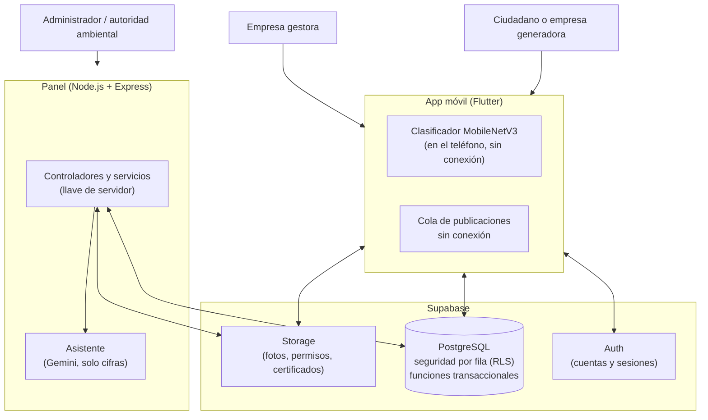
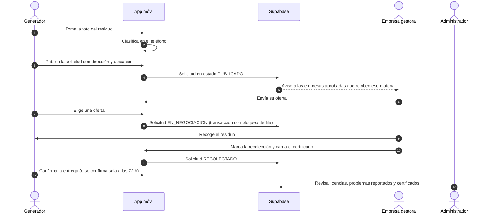

# EcoResiduos

<div align="center">


[](https://github.com/C3RLOSMORENO/EcoResiduos/releases/latest)

**Clasificación de residuos con la cámara, coordinación de su recolección con empresas gestoras autorizadas y seguimiento para las autoridades ambientales**

*Bucaramanga, Floridablanca, Girón, Piedecuesta, Barrancabermeja y Sabana de Torres (Santander, Colombia)*

</div>

---

## 1. Qué es

**EcoResiduos** conecta a quienes generan residuos (hogares, comercios e industrias) con empresas gestoras autorizadas, y le da a las autoridades ambientales (**CDMB**, **AMB** y **CAS**) una vista de lo que se recoge en su jurisdicción. Tiene tres partes:

1. **App móvil** ([`app/`](app/README.md)): identifica el residuo con la cámara, sin conexión, e indica cómo separarlo según la Resolución 2184 de 2019. Con ella el ciudadano publica la solicitud de recolección, compara ofertas y recibe el certificado; la empresa gestora hace ofertas, marca la recolección y carga el certificado.
2. **Panel de administración** ([`admin-panel/`](admin-panel/README.md)): verifica las licencias de las empresas gestoras, administra el catálogo de materiales, resuelve problemas reportados y genera reportes por municipio. Incluye un asistente que responde preguntas sobre los datos.
3. **Base de datos** ([`supabase/`](supabase/migrations/00000000000000_schema_completo.sql)): PostgreSQL en Supabase, con las reglas de negocio y de acceso dentro de la base.

---

## 2. Alcance

El sistema opera solo en seis municipios de Santander. Toda solicitud y todo registro de empresa gestora debe estar en uno de ellos; los demás municipios del departamento quedan fuera del alcance.

| Municipio | Subregión | Autoridad ambiental urbana | Corporación Autónoma Regional |
|---|---|---|---|
| Bucaramanga | Área Metropolitana | AMB | CDMB |
| Floridablanca | Área Metropolitana | AMB | CDMB |
| Girón | Área Metropolitana | AMB | CDMB |
| Piedecuesta | Área Metropolitana | AMB | CDMB |
| Barrancabermeja | Magdalena Medio | Secretaría de Medio Ambiente | CAS |
| Sabana de Torres | Magdalena Medio | Administración municipal | CAS |

---

## 3. Marco normativo

| Norma | Tema | Cómo se aplica |
|---|---|---|
| Resolución 2184 de 2019 (MinAmbiente) | Código de colores para la separación en la fuente | Blanco (aprovechables), verde (orgánicos) y negro (no aprovechables) en la clasificación y las guías de la app. |
| Decreto 1076 de 2015 | Decreto único del sector ambiente | Verificación de las licencias y permisos ambientales de las empresas gestoras. |
| Ley 1252 de 2008 y Decreto 4741 de 2005 | Residuos peligrosos (RESPEL) | Categoría propia y certificados de disposición final. |
| Ley 1672 de 2013 y Decreto 284 de 2018 | Residuos de aparatos eléctricos y electrónicos (RAEE) | Categoría propia y gestores especializados. |
| Resoluciones 0472 de 2017 y 1257 de 2021 | Residuos de construcción y demolición (RCD) | Cantidades en metros cúbicos. |
| Ley 1581 de 2012 y Decreto 1377 de 2013 | Protección de datos personales | Autorización al registrarse, [política de tratamiento](app/lib/legal/politica_datos.dart) y canal para consultas y reclamos. |
| Resolución 1519 de 2020 (MinTIC) | Accesibilidad web (WCAG 2.1 AA) | Objetivo del panel, verificado con pruebas y [declaración de accesibilidad](admin-panel/src/views/accesibilidad.ejs). |

---

## 4. Arquitectura

Es un monorepositorio con tres partes que se comunican a través de Supabase. No son microservicios: la app y el panel leen y escriben en la misma base, y la base decide qué puede ver o cambiar cada usuario.



| Parte | Organización | Puntos clave |
|---|---|---|
| App (`app/`) | Por funcionalidades, con repositorios entre las pantallas y Supabase | Clasificación en el teléfono, cola sin conexión, notificaciones en tiempo real. |
| Base de datos (`supabase/`) | Una migración única e idempotente | Seguridad por fila (RLS) en cada tabla; los cambios de estado críticos pasan por funciones `SECURITY DEFINER` que bloquean la fila (`FOR UPDATE`) para evitar condiciones de carrera. |
| Panel (`admin-panel/`) | Modelo-Vista-Controlador con vistas en el servidor (EJS) | CSP con nonce, protección CSRF, sesión en cookies `HttpOnly`; corre en Vercel o en cualquier servidor Node. |

---

## 5. Estructura del repositorio

```
EcoResiduos/
├── app/                      # App móvil (Flutter). Ver app/README.md
│   ├── assets/models/        # Modelo MobileNetV3 (.tflite) y etiquetas
│   ├── lib/                  # Código de la app
│   ├── model_training/       # Construcción del dataset y entrenamiento del modelo
│   └── test/                 # 124 pruebas
├── admin-panel/              # Panel web (Node.js + Express). Ver admin-panel/README.md
│   ├── api/                  # Entrada en Vercel
│   ├── src/                  # Controladores, servicios, vistas y estilos
│   └── pruebas/              # 153 pruebas y 9 recorridos en navegador
├── supabase/
│   ├── migrations/           # Esquema completo: tablas, RLS, funciones, triggers y buckets
│   └── functions/            # Función que borra fotos huérfanas del almacenamiento
└── .github/workflows/        # Integración continua, APK y consulta para mantener activo Supabase
```

---

## 6. Clasificación con la cámara

El modelo es un **MobileNetV3 Large** entrenado por el equipo con transferencia de aprendizaje ([`app/model_training/`](app/model_training/)), exportado a TensorFlow Lite y ejecutado en el teléfono con `tflite_flutter`. Recibe imágenes de 224 × 224 píxeles y distingue 8 clases: `APROVECHABLE`, `ORGANICO`, `ORDINARIO`, `PELIGROSO`, `RAEE`, `RCD`, `RIESGO_BIOLOGICO` y `FONDO` (la foto no muestra un residuo).

Cada foto se clasifica en cuatro versiones (recorte central, espejo, foto completa y recorte al 75 %) y se promedian los resultados. Con menos de 40 % de confianza, o si gana `FONDO`, la app no adivina: lo dice y ofrece alternativas. El detalle está en el [README de la app](app/README.md#3-clasificación-con-la-cámara).

---

## 7. Flujo de una recolección



---

## 8. Tecnologías

| Parte | Tecnología | Uso |
|---|---|---|
| App móvil | Flutter 3.47 / Dart 3.12 | Android, con temas claro y oscuro. |
| Clasificación | TensorFlow Lite (`tflite_flutter`) | Modelo propio ejecutado en el teléfono. |
| Ubicación | `geolocator` | Ubicación de la publicación y distancia a las solicitudes. |
| Panel | Node.js 24, Express, EJS y Tailwind CSS | Vistas generadas en el servidor. |
| Base de datos | PostgreSQL en Supabase | Tablas, seguridad por fila, funciones y triggers. |
| Autenticación | Supabase Auth | Cuentas, sesiones y recuperación de contraseña. |
| Archivos | Supabase Storage | Fotos, permisos ambientales y certificados en PDF. |
| Asistente del panel | Google Gemini | Respuestas sobre los datos del panel, con consultas de solo lectura. |

---

## 9. Puesta en marcha

### Requisitos

- [Flutter](https://docs.flutter.dev/get-started/install) estable (3.47 o superior).
- [Node.js](https://nodejs.org/) 24.x con npm.
- Un proyecto en [Supabase](https://supabase.com/).

### Paso 1: Base de datos

1. Abre el **SQL Editor** de Supabase y ejecuta completo [`supabase/migrations/00000000000000_schema_completo.sql`](supabase/migrations/00000000000000_schema_completo.sql). Es una sola migración idempotente: crea tablas, funciones, políticas RLS y buckets, y se puede volver a ejecutar sin perder datos.
2. Comprueba en **Storage** que existan los buckets:
   - `escaneos_ia`: fotos de los residuos (público).
   - `fotos_perfil`: logo y portada de los gestores (público).
   - `certificados`: certificados en PDF (público).
   - `permisos`: licencias ambientales (privado, solo el servidor lo lee).
3. En **Authentication → Providers → Email**, configura *Minimum password length* en **8** y *Password requirements* en **Letters and digits**. Así se aplica la misma regla de contraseñas que en la app aunque alguien llame a la API directamente.

### Paso 2: App móvil

Para probarla sin compilar, descarga `EcoResiduos.apk` de [Releases](https://github.com/C3RLOSMORENO/EcoResiduos/releases/latest) e instálalo en un teléfono Android (permite instalar desde fuentes desconocidas si lo pide). Para ejecutarla desde el código:

```bash
cd app
flutter pub get
flutter run
```

### Paso 3: Panel de administración

```bash
cd admin-panel
cp .env.example .env      # llena las variables (README del panel)
npm install
npm run build:css
npm run dev               # http://localhost:3000
```

### Paso 4: Producción

El panel se despliega en **Vercel** (Root Directory: `admin-panel`) o en cualquier servidor con Node 24. Las variables obligatorias y los pasos están en el [README del panel, sección 5](admin-panel/README.md#5-despliegue-en-producción).

Para que el plan gratis de Supabase no pause el proyecto por inactividad, el flujo [`mantener-supabase.yml`](.github/workflows/mantener-supabase.yml) hace una consulta cada 3 días; se activa agregando los secretos `SUPABASE_URL` y `SUPABASE_ANON_KEY` en GitHub.

---

## 10. Pruebas

| Parte | Pruebas | Comando |
|---|---|---|
| App móvil | 124 | `cd app && flutter analyze && flutter test` |
| Panel | 153, más 9 recorridos en navegador (escritorio y celular) | `cd admin-panel && npm run lint && npm test && npm run test:e2e` |

La integración continua ([`ci.yml`](.github/workflows/ci.yml)) corre el análisis y las pruebas de ambas partes en cada cambio.

---

## 11. Seguridad y datos personales

- **Seguridad por fila (RLS):** la base solo deja ver y cambiar a cada usuario lo que le corresponde, aunque alguien use la llave pública fuera de la app.
- **Transacciones:** aceptar una oferta, marcar una recolección o cancelar se hace con funciones de la base que bloquean la fila, para que dos acciones simultáneas no dejen la solicitud en un estado inválido.
- **Validación en la base:** cantidades mayores que cero, NIT único por empresa y estados permitidos, además de la validación de la app y el panel.
- **Panel:** CSP con nonce por petición, protección CSRF, cookies `HttpOnly`, contraseña de administrador de al menos 12 caracteres y reportes en Excel que escriben cada celda como valor (sin inyección de fórmulas).
- **Datos personales (Ley 1581 de 2012):** nadie se registra sin autorizar el tratamiento de sus datos; quien ya tenía cuenta lo autoriza la próxima vez que entra. La política está publicada en el panel (`/privacidad`) y en la app.
- **Fotos:** la clasificación ocurre en el teléfono y no se envía a ningún servicio de inteligencia artificial. Las fotos de escaneos y publicaciones sí se guardan en Supabase, en un bucket público para que la app pueda mostrarlas; quien tenga la URL exacta puede verlas (ver *Limitaciones conocidas* en el [README del panel](admin-panel/README.md#limitaciones-conocidas)).

---

## 12. Autoría

Proyecto de grado de la Universidad de Santander (UDES) para la gestión de residuos y la economía circular en seis municipios de Santander.

- **Repositorio:** [C3RLOSMORENO/EcoResiduos](https://github.com/C3RLOSMORENO/EcoResiduos)
