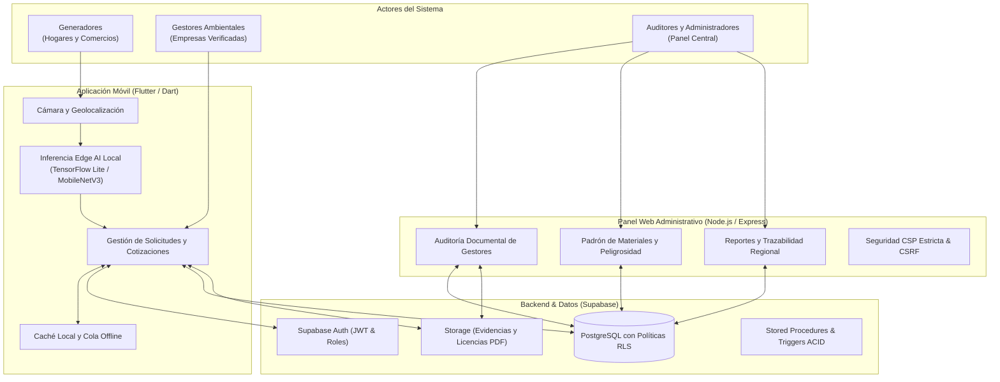
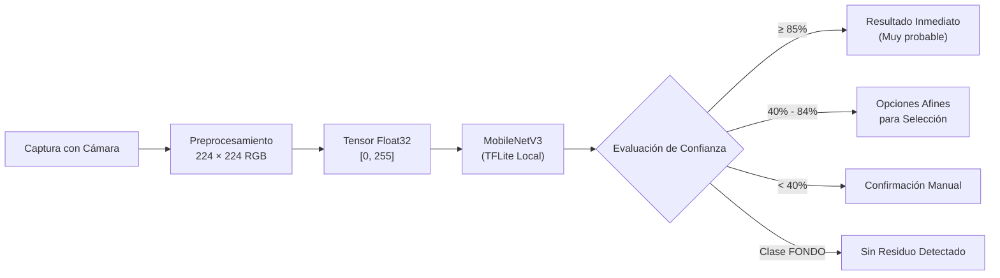
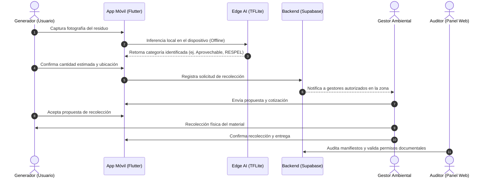

# EcoResiduos

Plataforma de economía circular y gestión integral de residuos para el departamento de Santander (Colombia). Conecta a generadores de residuos (hogares, comercios e industrias) con empresas gestoras autorizadas y autoridades ambientales, facilitando la clasificación automática en el dispositivo mediante visión por computador, la negociación y recolección trazable de materiales, y la verificación documental de los permisos de los gestores antes de permitirles operar.

---

## Tabla de contenidos

1. [Alcance y Marco Normativo](#alcance-y-marco-normativo)
2. [Arquitectura del Sistema](#arquitectura-del-sistema)
3. [Modelo de Inteligencia Artificial (Edge AI)](#modelo-de-inteligencia-artificial-edge-ai)
4. [Flujo Operativo de Recolección](#flujo-operativo-de-recolección)
5. [Estructura del Monorepo](#estructura-del-monorepo)
6. [Stack Tecnológico](#stack-tecnológico)
7. [Guía de Puesta en Marcha](#guía-de-puesta-en-marcha)
   - [Prerrequisitos](#prerrequisitos)
   - [Configuración de Base de Datos y Supabase](#configuración-de-base-de-datos-y-supabase)
   - [Aplicación Móvil (Flutter)](#aplicación-móvil-flutter)
   - [Panel Administrativo (Node.js / Express)](#panel-administrativo-nodejs--express)
8. [Suites de Pruebas Automatizadas](#suites-de-pruebas-automatizadas)
9. [Seguridad y Control de Acceso](#seguridad-y-control-de-acceso)
10. [Licencia y Autoría](#licencia-y-autoría)

---

## Alcance y Marco Normativo

EcoResiduos opera en el Área Metropolitana de Bucaramanga y municipios de Santander (Bucaramanga, Floridablanca, Girón, Piedecuesta, Lebrija y Rionegro), articulándose con las directrices de autoridades ambientales como la **CDMB**, el **AMB** y la **CAS**.

La plataforma clasifica y gestiona los residuos conforme a la **Resolución 2184 de 2019** del Ministerio de Ambiente y normativas sectoriales vigentes:

| Categoría | Residuos Incluidos | Destino / Manejo | Color / Distintivo |
|---|---|---|---|
| **Aprovechables** | Plástico, cartón, papel, vidrio, metales | Reciclaje y reincorporación industrial | Blanco |
| **Orgánicos** | Restos de alimentos, podas, biomasa | Compostaje y valorización biológica | Verde |
| **Ordinarios** | Papel higiénico, servilletas, empaques sucios | Relleno sanitario (disposición final) | Negro |
| **RESPEL (Peligrosos)** | Químicos, aceites usados, baterías, solventes | Incineración controlada / Celda de seguridad | Naranja / Amarillo |
| **RAEE** | Equipos de cómputo, electrodomésticos, cables | Desensamble y recuperación de componentes | Morado |
| **RCD (Escombros)** | Concreto, ladrillo, cerámicos, tierra de excavación | Plantas de trituración y agregados | Terracota / Café |
| **Riesgo Biológico** | Gasas, guantes, material biosanitario | Termodestrucción / Autoclave hospitalario | Rojo |

---

## Arquitectura del Sistema



---

## Modelo de Inteligencia Artificial (Edge AI)

La clasificación visual no depende de servicios en la nube ni de APIs de terceros. El análisis se ejecuta **100% de manera local en el dispositivo del usuario** mediante inferencia embebida con **TensorFlow Lite**:

### Pipeline de Visión por Computador



### Especificaciones del Modelo

| Parámetro | Valor / Configuración |
|---|---|
| **Arquitectura Base** | MobileNetV3 Large (Transfer Learning y Fine-Tuning) |
| **Entorno de Inferencia** | `tflite_flutter` (Inferencia nativa C++ en iOS / Android) |
| **Resolución de Entrada** | $224 \times 224 \times 3$ (RGB) |
| **Clases Reconocidas** | 8 (`APROVECHABLE`, `ORGANICO`, `ORDINARIO`, `PELIGROSO`, `RAEE`, `RCD`, `RIESGO_BIOLOGICO`, `FONDO`) |
| **Detección de Vacío** | Clase `FONDO` para descartar fotografías que no correspondan a residuos |
| **Umbrales de Decisión** | $\ge 85\%$ (Confianza Alta / "Muy probable") · $40\% - 84\%$ (Muestra opciones afines) · $< 40\%$ (Pide confirmación manual) |
| **Conectividad Requerida** | **Ninguna (Funciona 100% sin conexión a Internet)** |

---

## Flujo Operativo de Recolección



---

## Estructura del Monorepo

```
EcoResiduos/
├── app/                              # Aplicación móvil cliente (Flutter)
│   ├── assets/
│   │   ├── branding/                 # Logotipos y firmas visuales
│   │   ├── fonts/                    # Public Sans y tipografías locales
│   │   └── models/
│   │       ├── ecoresiduos_model.tflite # Modelo de visión optimizado
│   │       └── labels.txt            # Clases del clasificador
│   ├── lib/
│   │   ├── features/auth/            # Inicio de sesión, registro y padrón
│   │   ├── features/solicitudes/     # Creación, cotización y entrega de residuos
│   │   ├── models/                   # Entidades de dominio (WasteItem, Gestor, Solicitud)
│   │   ├── services/                 # Inferencia TFLite, Supabase y geolocalización
│   │   └── theme/                    # Tokens M3, paleta de colores y bordes
│   ├── model_training/               # Pipeline de entrenamiento y aumento en TensorFlow
│   │   ├── train.py                  # Script de entrenamiento reproducible
│   │   └── entrenar_en_colab.ipynb   # Notebook de experimentación en GPU
│   └── test/                         # 104 pruebas unitarias, de servicio y widgets
│
├── admin-panel/                      # Panel web de gestión y auditoría (Express/EJS)
│   ├── src/
│   │   ├── controllers/              # Controladores de solicitudes, gestores y reportes
│   │   ├── middlewares/              # Autenticación, CSRF, validadores de ID y seguridad
│   │   ├── routes/                   # Definición de rutas del panel
│   │   ├── services/                 # Integración con base de datos y geocodificación
│   │   └── views/                    # Plantillas EJS (Dashboard, Auditoría, Reportes)
│   ├── pruebas/                      # 66 pruebas de integración, CSP, CSRF y WCAG
│   └── tailwind.config.js            # Configuración de diseño y tokens Material 3
│
└── supabase/
    └── migrations/                   # Scripts DDL, políticas RLS y triggers en PostgreSQL
```

---

## Stack Tecnológico

| Capa | Tecnología | Propósito |
|---|---|---|
| **App Móvil** | Flutter 3.x / Dart 3.x | Aplicación cliente multiplataforma para Generadores y Gestores |
| **Visión Computacional** | TensorFlow Lite (`tflite_flutter`) | Inferencia local offline en dispositivo móvil |
| **Geolocalización** | `geolocator` | Cálculo de distancias y radio de atención de gestores |
| **Panel Web** | Node.js (v18+) & Express | Sistema administrativo y de auditoría ambiental |
| **Plantillas Web** | EJS (Embedded JavaScript) | Renderizado del lado del servidor con protección XSS |
| **Estilos Web** | Tailwind CSS | Sistema visual basado en roles de Material Design 3 |
| **Base de Datos** | PostgreSQL (Supabase) | Esquema relacional con integridad referencial estricta |
| **Autenticación** | Supabase Auth | Sesiones basadas en JWT con tokens de refresco |
| **Almacenamiento** | Supabase Storage | Gestión de archivos con URLs firmadas temporales |

---

## Guía de Puesta en Marcha

### Prerrequisitos

- [Git](https://git-scm.com/) instalado en el sistema.
- [Flutter SDK](https://docs.flutter.dev/get-started/install) versión 3.24 o superior.
- [Node.js](https://nodejs.org/) versión 18.x o superior con npm.
- Un proyecto configurado en [Supabase](https://supabase.com/).

---

### Configuración de Base de Datos y Supabase

1. Ejecuta los archivos SQL ubicados en `supabase/migrations/` en el editor SQL de tu instancia de Supabase.
2. Verifica la existencia de los buckets de almacenamiento:
   - `solicitudes`: Almacenamiento de fotografías de residuos.
   - `licencias`: Almacenamiento privado de certificaciones ambientales en PDF.

---

### Aplicación Móvil (Flutter)

1. Ingresa a la carpeta del cliente móvil:
   ```bash
   cd app
   ```

2. Descarga las dependencias de Flutter:
   ```bash
   flutter pub get
   ```

3. Verifica que los archivos del modelo estén presentes en `assets/models/`:
   - `ecoresiduos_model.tflite`
   - `labels.txt`

4. Ejecuta la aplicación en tu dispositivo o emulador:
   ```bash
   flutter run
   ```

---

### Panel Administrativo (Node.js / Express)

1. Ingresa a la carpeta del panel web:
   ```bash
   cd admin-panel
   ```

2. Crea el archivo de variables de entorno `.env` a partir de `.env.example`:
   ```bash
   cp .env.example .env
   ```

3. Completa las variables necesarias:
   ```env
   PORT=3000
   NODE_ENV=development
   SUPABASE_URL=https://tu-proyecto.supabase.co
   SUPABASE_ANON_KEY=tu_anon_key
   SUPABASE_SERVICE_ROLE_KEY=tu_service_role_key
   COOKIE_SECRET=tu_clave_secreta_para_firmar_cookies
   ```

4. Instala dependencias y compila los estilos CSS:
   ```bash
   npm install
   npm run build:css
   ```

5. Inicia el servidor en modo desarrollo:
   ```bash
   npm run dev
   ```
   Accede a la interfaz desde: `http://localhost:3000`.

---

## Suites de Pruebas Automatizadas

El proyecto mantiene pruebas automatizadas para garantizar la estabilidad y la no regresión en ambos subsistemas:

### 1. Pruebas de la Aplicación Móvil (104 Tests)
```bash
cd app
flutter test
```
- **Flujos de autenticación:** Login, registro de generadores y gestores con validación de NIT.
- **Inferencia y visión:** Casos de alta confianza, baja confianza y descarte de imágenes sin residuos (`FONDO`).
- **Manejo de solicitudes:** Creación con geolocalización, sincronización en cola offline y filtrado de directorio.
- **Accesibilidad y humo:** Renderizado completo de pantallas en modo claro y modo oscuro.

### 2. Pruebas del Panel de Administración (66 Tests)
```bash
cd admin-panel
npm test
```
- **Seguridad HTTP:** Validación de cabeceras CSP con nonces dinámicos, cookies `HttpOnly`, `SameSite=Strict` y HSTS.
- **Protección CSRF:** Rechazo de peticiones no autorizadas y validación estricta de tokens.
- **Auditoría de Accesibilidad:** Cumplimiento de estándares WCAG 2.1 AA (contraste, etiquetas de región, foco visible).
- **Lógica de negocio:** Flujo de aprobación/rechazo de gestores, resolución de novedades y reporte CSV con protección contra inyección de fórmulas.

---

## Seguridad y Control de Acceso

- **Aislamiento por RLS:** Todas las tablas de PostgreSQL implementan Row Level Security. Cada usuario solo puede consultar o modificar la información que le corresponde.
- **Inferencia en el Borde (Edge Privacy):** Las imágenes analizadas por la cámara para clasificar residuos no se envían a servidores externos para su análisis; se procesan de forma privada dentro de la memoria del teléfono.
- **Mitigación de Ataques Web:** El panel administrativo opera con Content Security Policy sin `unsafe-inline` ni `unsafe-eval`, limitador de tasa de intentos de autenticación y sanitización en la capa de vistas.

---

## Licencia y Autoría

Desarrollado para la gestión ambiental y el fomento de la economía circular en Santander, Colombia.  
Repositorio del proyecto: [C3RLOSMORENO/EcoResiduos](https://github.com/C3RLOSMORENO/EcoResiduos)
