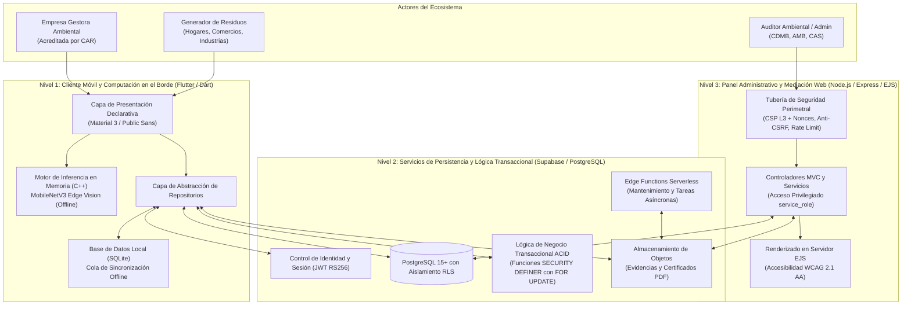
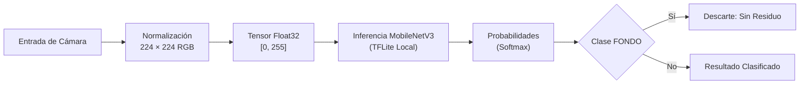
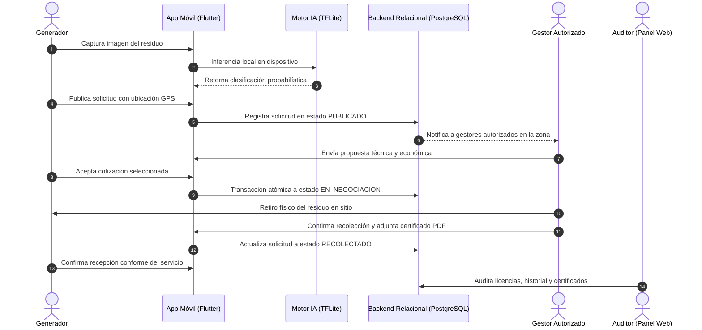

# EcoResiduos

<div align="center">


-brightgreen?style=for-the-badge)

[-2ea44f?style=for-the-badge&logo=android&logoColor=white)](https://github.com/C3RLOSMORENO/EcoResiduos/releases/latest)

**Plataforma de Trazabilidad Logística de Residuos, Clasificación por Visión Computacional en Dispositivo y Auditoría Ambiental**

*Alcance Territorial Acotado: Bucaramanga, Floridablanca, Girón, Piedecuesta, Barrancabermeja y Sabana de Torres (Santander, Colombia)*

</div>

---

## 1. Descripción General del Sistema

**EcoResiduos** es una plataforma de software diseñada para la articulación logística y trazabilidad de residuos sólidos entre generadores (residenciales, comerciales e industriales), empresas gestoras debidamente acreditadas y autoridades ambientales con jurisdicción territorial (**CDMB**, **AMB** y **CAS**).

El sistema se enfoca en tres componentes técnicos fundamentales:
1. **Clasificación Asistida en el Borde (*Edge AI*):** Modelo de visión artificial embebido directamente en el cliente móvil para orientar la separación en la fuente bajo la Resolución 2184 de 2019, ejecutándose sin requerir conectividad de datos.
2. **Intermediación y Negociación Transaccional:** Registro georreferenciado de solicitudes de retiro de material, recepción de ofertas técnico-económicas por parte de gestores autorizados y confirmación conforme de entrega.
3. **Fiscalización Documental y Custodia:** Validación de licencias ambientales y custodia digital de certificados de disposición final o aprovechamiento en formato PDF.

---

## 2. Delimitación Territorial y Alcance Operativo

El sistema **no cubre la totalidad del departamento de Santander**, sino que restringe su alcance técnico y operativo a seis (6) municipios priorizados debido a su articulación con los planes de gestión integral de residuos sólidos (PGIRS) y la jurisdicción de las Corporaciones Autónomas Regionales participantes:

```
┌──────────────────┬──────────────────────────────┬──────────────────────────────┬───────────────────────────────┐
│ Municipio        │ Subregión Departamental      │ Autoridad Ambiental Urbana   │ Corporación Regional (CAR)    │
├──────────────────┼──────────────────────────────┼──────────────────────────────┼───────────────────────────────┤
│ Bucaramanga      │ Área Metropolitana (AMB)     │ Área Metropolitana (AMB)     │ CDMB                          │
│ Floridablanca    │ Área Metropolitana (AMB)     │ Área Metropolitana (AMB)     │ CDMB                          │
│ Girón            │ Área Metropolitana (AMB)     │ Área Metropolitana (AMB)     │ CDMB                          │
│ Piedecuesta      │ Área Metropolitana (AMB)     │ Área Metropolitana (AMB)     │ CDMB                          │
│ Barrancabermeja  │ Magdalena Medio Santandereano│ Secretaría de Medio Ambiente │ CAS                           │
│ Sabana de Torres │ Magdalena Medio Santandereano│ Administración Municipal     │ CAS                           │
└──────────────────┴──────────────────────────────┴──────────────────────────────┴───────────────────────────────┘
```

> **Nota de Delimitación:** Toda solicitud de recolección y todo registro de empresa gestora requiere asociar uno de estos seis municipios validados dentro de las reglas de negocio del sistema. Los 81 municipios restantes de Santander se encuentran fuera del alcance del presente proyecto.

---

## 3. Marco Regulatorio y Estándares Técnicos

La plataforma implementa los lineamientos de la normativa ambiental colombiana vigente:

```
┌────────────────────────────────────────────────────────────────────────────────────────┐
│                                 MARCO NORMATIVO COLOMBIANO                             │
├──────────────────────────┬─────────────────────────────┬───────────────────────────────┤
│ Regulación               │ Ámbito de Aplicación        │ Implementación en el Sistema  │
├──────────────────────────┼─────────────────────────────┼───────────────────────────────┤
│ Resolución 2184 de 2019  │ Código Nacional de Colores  │ Blanco (Aprovechables)        │
│ (MinAmbiente)            │ para Separación en Fuente   │ Verde (Orgánicos)             │
│                          │                             │ Negro (No Aprovechables)      │
├──────────────────────────┼─────────────────────────────┼───────────────────────────────┤
│ Decreto 1076 de 2015     │ Decreto Único Reglamentario │ Control documental de         │
│ (Sector Ambiente)        │ del Sector Ambiental        │ licencias expedidas por CAR   │
├──────────────────────────┼─────────────────────────────┼───────────────────────────────┤
│ Ley 1252 de 2008         │ Gestión Integral de         │ Trazabilidad estricta y       │
│ y Decreto 4741 de 2005   │ Residuos Peligrosos (RESPEL)│ custodia de certificados      │
├──────────────────────────┼─────────────────────────────┼───────────────────────────────┤
│ Ley 1672 de 2013         │ Gestión Integral de Residuos│ Canalización hacia programas  │
│ y Decreto 284 de 2018    │ Eléctricos y Electrónicos   │ posconsumo autorizados        │
├──────────────────────────┼─────────────────────────────┼───────────────────────────────┤
│ Resolución 0472 de 2017  │ Residuos de Construcción y  │ Cubicaje en M3 y articulación │
│ y Resolución 1257 de 2021│ Demolición (RCD / Escombros)│ con plantas de agregados      │
└──────────────────────────┴─────────────────────────────┴───────────────────────────────┘
```

---

## 4. Arquitectura del Software

El sistema implementa una **Arquitectura Desacoplada de Tres Niveles basada en Backend-as-a-Service (BaaS) con Computación en el Borde (*Edge Computing*) y Servidor de Auditoría Web (MVC)**. 

No corresponde a una arquitectura de microservicios distribuidos independientes (tipo contenedores con intermediarios de mensajería asíncrona como Kafka o RabbitMQ), sino a una **arquitectura monorepo modular desacoplada**, donde cada subsistema cumple un rol específico dentro del ciclo de vida del dato:



### Especificación de Niveles Arquitectónicos

| Nivel del Sistema | Subsistema | Patrón Arquitectónico | Responsabilidad de Ingeniería | Protocolo / Interfaz |
|---|---|---|---|---|
| **Nivel 1: Edge Client** | Cliente Móvil (`app/`) | *Feature-First Layered Architecture* + *Repository Pattern* | Captura de imagen, inferencia visual autónoma sin red, publicación georreferenciada y encolamiento transaccional offline. | Inferencia en memoria C++, HTTPS / TLS 1.3, WebSockets. |
| **Nivel 2: BaaS / Persistencia** | Capa Central (`supabase/`) | *BaaS Relacional con Aislamiento Zero-Trust* | Control de acceso basado en identidad, ejecución atómica de ofertas y adjudicaciones (ACID), almacenamiento seguro y triggers inmutables. | SQL ANSI, PostgREST API, RPC Functions, S3 Storage API. |
| **Nivel 3: Administrative Web** | Panel Web (`admin-panel/`) | *Model-View-Controller (MVC)* con SSR y *Middleware Pipeline* | Fiscalización documental de licencias ambientales, administración del catálogo de residuos, mediación de novedades y reportería regional. | HTTPS / TLS 1.3, Cookies HttpOnly/Strict, CSP Nonces. |

---

## 5. Estructura del Monorepo

```
EcoResiduos/
├── app/                              # Aplicación móvil cliente (Flutter / Dart)
│   ├── assets/models/                # Modelo MobileNetV3 cuantizado y etiquetas
│   ├── lib/features/auth/            # Autenticación, registro y verificación de directorio
│   ├── lib/features/solicitudes/     # Ciclo de publicación, negociación y recolección
│   ├── lib/models/                   # Entidades de dominio
│   ├── lib/services/                 # Servicios de visión artificial y geolocalización
│   └── test/                         # Suite de 117 pruebas unitarias y de widgets
│
├── admin-panel/                      # Panel web de auditoría (Node.js / Express / EJS)
│   ├── src/controllers/              # Controladores de negocio y mediación
│   ├── src/middlewares/              # Cabeceras CSP, mitigación CSRF y control de sesiones
│   ├── src/views/                    # Plantillas del servidor con protección XSS
│   ├── pruebas/                      # 129 pruebas de integración y accesibilidad, más las de navegador
│   └── tailwind.config.js            # Tokens visuales y diseño accesible
│
└── supabase/
    └── migrations/                   # Esquema relacional, políticas RLS y triggers ACID
```

---

## 6. Módulo de Visión Computacional en el Dispositivo

La inferencia visual se ejecuta enteramente en la memoria del dispositivo móvil utilizando la biblioteca nativa en C++ `tflite_flutter`, garantizando privacidad total y disponibilidad sin conexión.



### Especificaciones Técnicas del Modelo

| Parámetro | Especificación |
|---|---|
| **Arquitectura de Red** | MobileNetV3 Large con Transfer Learning y Fine-Tuning |
| **Formato de Ejecución** | TensorFlow Lite (`.tflite`) optimizado para procesadores móviles |
| **Dimensión de Entrada** | $1 \times 224 \times 224 \times 3$ (Canales RGB normalizados) |
| **Espacio de Clasificación** | 8 Clases (`APROVECHABLE`, `ORGANICO`, `ORDINARIO`, `PELIGROSO`, `RAEE`, `RCD`, `RIESGO_BIOLOGICO`, `FONDO`) |
| **Mecanismo Anti-Ruido** | Clase `FONDO` para discriminación de capturas que no contienen residuos |
| **Latencia Típica** | Inferior a 200 ms por cuadro |
| **Conectividad Requerida** | Ninguna (Operación autónoma sin internet) |

---

## 7. Flujo Operativo de Recolección y Trazabilidad



---

## 8. Pila Tecnológica

| Capa / Subsistema | Tecnología | Propósito de Ingeniería |
|---|---|---|
| **Aplicación Móvil** | Flutter 3.24+ / Dart 3.5+ | Cliente multiplataforma reactivo para generadores y empresas gestoras. |
| **Motor de Inferencia** | TensorFlow Lite (`tflite_flutter`) | Clasificación visual en tiempo real en el hardware del teléfono. |
| **Geolocalización** | `geolocator` | Georreferenciación precisa y cálculo de distancias de atención. |
| **Panel Administrativo** | Node.js (v18+) & Express | Sistema de auditoría, control de expedientes y reportes regionales. |
| **Capa de Presentación Web** | EJS & Tailwind CSS | Renderizado en servidor con diseño accesible conforme a WCAG 2.1 AA. |
| **Motor de Base de Datos** | PostgreSQL 15+ (Supabase) | Esquema relacional con integridad referencial, triggers y aislamiento RLS. |
| **Autenticación** | Supabase Auth (JWT) | Control de sesiones seguro basado en tokens y roles de usuario. |
| **Almacenamiento de Archivos**| Supabase Storage | Gestión de evidencias fotográficas, licencias y certificados en PDF. |

---

## 9. Guía de Puesta en Marcha

### Prerrequisitos de Entorno

- [Git](https://git-scm.com/) instalado en el sistema operativo.
- [Flutter SDK](https://docs.flutter.dev/get-started/install) versión 3.24 o superior.
- [Node.js](https://nodejs.org/) versión 18.x o superior con npm.
- Un proyecto configurado en [Supabase](https://supabase.com/).

---

### Paso 1: Configuración de Base de Datos (Supabase)

1. Ejecuta los archivos SQL en orden secuencial desde `supabase/migrations/` en el editor SQL de Supabase:
   - `20260924000000_reglas_negocio_postulaciones_materiales.sql`
   - `20260925000000_seguridad_rls_y_perfiles.sql`
   - `20260926000000_storage_fotos.sql`
   - `20260927000000_notificaciones_historial_horario.sql`
   - `20260928000000_horario_autoridades.sql`
   - `20260930000000_certificado_recoleccion.sql`
   - `20261001000000_valor_postulacion_y_certificado.sql`
   - `20261002000000_registro_gestor_nuevo.sql`
   - `20261003000000_cancelar_solicitud_admin.sql`
   - `20261003000100_motivo_verificacion_y_avisos_gestor.sql`
   - `20261003000200_resolucion_problemas_reportados.sql`

2. Comprueba que los buckets de almacenamiento existan:
   - `escaneos_ia`: Fotografías de los residuos publicados y escaneados.
   - `fotos_perfil`: Logo y portada de los gestores.
   - `certificados`: Certificados de disposición final y aprovechamiento en PDF.
   - `permisos`: Documentos de licencias ambientales (bucket privado con acceso exclusivo de servidor).

---

### Descarga Directa de la Aplicación Móvil (Android APK)

Si deseas probar la aplicación directamente en un dispositivo Android sin compilar el código fuente:

1. Ve a la sección de **[Releases del Repositorio](https://github.com/C3RLOSMORENO/EcoResiduos/releases/latest)**.
2. Descarga el archivo **`EcoResiduos.apk`**.
3. En tu teléfono Android, abre el archivo descargado. Si Android te solicita permiso para instalar aplicaciones de fuentes desconocidas, habilítalo en los ajustes del navegador o gestor de archivos.
4. Presiona **Instalar** y ¡listo!

---

### Paso 2: Ejecución Local de la Aplicación Móvil (Flutter)


```bash
# Ingresar a la carpeta de la aplicación
cd app

# Instalar dependencias de Flutter
flutter pub get

# Ejecutar en el dispositivo o emulador conectado
flutter run
```

---

### Paso 3: Ejecución del Panel Administrativo (Node.js / Express)

```bash
# Ingresar a la carpeta del panel
cd admin-panel

# Crear archivo de variables de entorno
cp .env.example .env

# Instalar dependencias y compilar estilos CSS
npm install
npm run build:css

# Iniciar el servidor en modo desarrollo
npm run dev
```

El panel estará disponible en `http://localhost:3000`.

---

## 10. Suites de Pruebas Automatizadas

El proyecto mantiene **246 pruebas automatizadas**, más 7 recorridos en navegador con Playwright, que garantizan la estabilidad y no regresión:

```
┌───────────────────────────────────────────────┬──────────────┬──────────────┐
│ Suite de Pruebas                              │ Cantidad     │ Estado       │
├───────────────────────────────────────────────┼──────────────┼──────────────┤
│ App Móvil (Flutter / Dart)                    │ 117 Tests    │ 100% Pass ✅ │
│ Panel Administrativo (Node.js / Express / EJS)│ 129 Tests    │ 100% Pass ✅ │
├───────────────────────────────────────────────┼──────────────┼──────────────┤
│ Total Pruebas Automatizadas                   │ 246 Tests    │ 100% Pass ✅ │
└───────────────────────────────────────────────┴──────────────┴──────────────┘
```

### Ejecutar Pruebas de la Aplicación Móvil (117 Tests)
```bash
cd app
flutter test
```

### Ejecutar Pruebas del Panel Administrativo (129 Tests)
```bash
cd admin-panel
npm test
npm run test:e2e   # recorridos en navegador (escritorio y celular)
```

---

## 11. Seguridad y Privacidad

- **Políticas Row Level Security (RLS):** Cada consulta está restringida en el motor de base de datos para que los generadores y gestores solo accedan a sus propios registros.
- **Transacciones ACID:** Los cambios de estado críticos se realizan a través de funciones almacenadas `SECURITY DEFINER` con bloqueos pesimistas (`FOR UPDATE`), previniendo condiciones de carrera.
- **Seguridad Web:** El panel implementa Content Security Policy (CSP) con nonces criptográficos dinámicos, cookies `HttpOnly` (`SameSite=Lax` las de sesión y `Strict` la de CSRF), protección contra falsificación de petición (CSRF) y reportes en Excel que escriben cada celda como valor, nunca como fórmula, para evitar la inyección de fórmulas.
- **Privacidad de Imágenes:** El procesamiento visual opera 100% en la memoria local del teléfono, garantizando que ninguna captura sea transmitida a servicios externos para su análisis.

---

## 12. Autoría y Licencia

Proyecto de grado desarrollado para la gestión ambiental integral y el impulso de la economía circular en municipios seleccionados de Santander, Colombia.

- **Repositorio:** [C3RLOSMORENO/EcoResiduos](https://github.com/C3RLOSMORENO/EcoResiduos)
