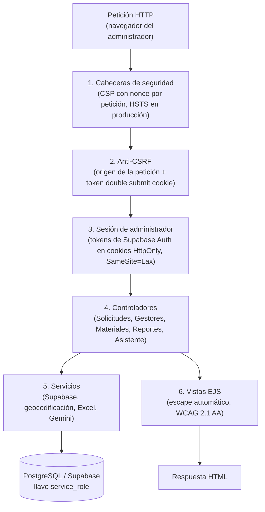

# EcoResiduos — Panel Administrativo y de Auditoría Ambiental

<div align="center">


**Sistema web de fiscalización documental, trazabilidad regional y mediación para autoridades ambientales y administradores**

*Jurisdicción: 6 Municipios de Santander (AMB / CDMB / CAS)*

</div>

---

## 1. Descripción del Subsistema

El **Panel Administrativo** de EcoResiduos es una plataforma web desarrollada en **Node.js y Express**, diseñada para que las autoridades ambientales (**CDMB**, **AMB**, **CAS**) y los administradores del sistema auditen la operación de recolección en los seis (6) municipios priorizados de Santander: **Bucaramanga, Floridablanca, Girón, Piedecuesta, Barrancabermeja y Sabana de Torres**.

### Funcionalidades Principales
- **Auditoría Documental de Gestores:** Revisión de licencias ambientales en PDF, validación de NIT, verificación de materiales autorizados por empresa y registro de decisiones administrativas (Aprobado, Rechazado, Suspendido).
- **Catálogo de Materiales y Peligrosidad:** Administración de la matriz de residuos bajo la **Resolución 2184 de 2019**, definiendo códigos de color oficiales, peligrosidad (RESPEL) y directrices técnicas de manejo.
- **Trazabilidad y Mediación de Novedades:** Panel de mediación de incidentes reportados por generadores o gestores durante la recolección física.
- **Consolidación Estadística y Reportes:** Generación de métricas de recolección por municipio y descarga del reporte en Excel (.xlsx), con los filtros aplicados, las notas para leer las cifras y solo datos agregados.
- **Asistente conversacional (burbuja flotante):** Desde cualquier pantalla, el administrador abre el asistente con el botón de abajo a la derecha y pregunta en lenguaje natural («¿cuántos gestores reciben aceite usado?», «¿cuántas publicaciones se completaron este mes?») y recibe la respuesta con las cifras reales de la base. Usa Gemini con llamadas a funciones: el modelo solo puede elegir entre ocho consultas de solo lectura con parámetros validados ([`src/services/consultasAsistente.js`](src/services/consultasAsistente.js)); nunca escribe SQL ni recibe datos personales de los ciudadanos (Ley 1581 de 2012), y cada respuesta indica qué consultas usó. El tema se limita en el código: en la primera ronda el modelo está obligado a clasificar la pregunta, y si no trata del panel (política, noticias, «ignora tus reglas»…) el servidor responde con un texto fijo sin que el modelo redacte nada. Si un modelo de Gemini está saturado o sin cuota, la pregunta se repite con el siguiente de la lista.
- **Accesibilidad:** Objetivo WCAG 2.1 nivel AA, la referencia de la Resolución 1519 de 2020 de MinTIC, verificado con pruebas automáticas. Además, un botón flotante (abajo a la derecha, también en el inicio de sesión, o con Alt + Shift + A) ofrece preferencias de visualización: tamaño de texto hasta 150 %, alto contraste, espaciado de texto de WCAG 1.4.12, fuente Atkinson Hyperlegible, enlaces subrayados, sin animaciones, máscara de lectura y lectura en voz alta. La declaración pública está en [`/accesibilidad`](src/views/accesibilidad.ejs).

---

## 2. Arquitectura de Software

El panel implementa el patrón **Model-View-Controller (MVC)** con renderizado en el servidor (*Server-Side Rendering*) a través de EJS. Cada petición atraviesa esta cadena de middlewares ([`src/crearApp.js`](src/crearApp.js)):



El límite de intentos de inicio de sesión (5 por correo y 20 por IP cada 15 minutos) se aplica en el controlador de autenticación, no en toda petición.

### Desglose de Capas Arquitectónicas

| Capa del Panel | Componentes Principales | Responsabilidad |
|---|---|---|
| **Seguridad** | `src/middlewares/` | Nonces de la CSP, validación anti-CSRF, sesión de administrador y validación de identificadores. |
| **Enrutamiento y Control** | `src/routes/`, `src/controllers/` | Rutas, validación de entradas y respuesta de cada pantalla. Los controladores nunca consultan Supabase directamente (lo exige una prueba). |
| **Servicios e Integración** | `src/services/`, `src/config/` | Consultas a Supabase con `service_role`, geocodificación (Nominatim), reportes y asistente (Gemini). |
| **Presentación Accesible** | `src/views/`, `src/views/partials/` | Plantillas EJS conformes a WCAG 2.1 AA, navegación por teclado y contraste de color calibrado. |

### Estructura de Directorios

```
admin-panel/
├── api/
│   └── index.js                  # Punto de entrada en Vercel (función serverless)
├── server.js                     # Punto de entrada en un servidor Node (npm start)
├── src/
│   ├── crearApp.js               # Aplicación Express: middlewares y rutas
│   ├── config/                   # Cliente Supabase (service_role) y revisión de variables de entorno
│   ├── controllers/              # Controladores de cada pantalla y del asistente
│   ├── middlewares/              # Seguridad (CSP), CSRF, sesión y validación de identificadores
│   ├── routes/                   # Rutas del panel
│   ├── services/                 # Supabase, geocodificación, reportes y asistente
│   ├── utils/                    # Excel, fechas, filtros, íconos, límites de archivos…
│   ├── views/                    # Plantillas EJS
│   └── public/                   # CSS compilado, JavaScript del navegador e imágenes
├── pruebas/                      # 147 pruebas de integración, seguridad y WCAG, más las de navegador (e2e/)
├── vercel.json                   # Configuración del despliegue en Vercel
├── tailwind.config.js            # Tokens de diseño (colores y tipografía de la app)
└── package.json                  # Dependencias y scripts
```

---

## 3. Seguridad y Almacenamiento

El logo y la portada que cada gestor pone desde la app están en el bucket público `fotos_perfil`. El panel los muestra en la lista, la ficha, el inicio y las solicitudes, y desde la ficha se pueden quitar si son inapropiados; sin foto se muestran las iniciales de la empresa. Las fotos de los ciudadanos no se muestran: el panel no las necesita para su trabajo (Ley 1581 de 2012, principios de finalidad y necesidad).

Los permisos ambientales se guardan en el bucket privado `permisos`, bajo la ruta `admin/<id>/<aleatorio>.pdf` cuando los sube el panel. Desde el panel se aceptan PDF reales de hasta **4 MB**. Al abrir un permiso o un certificado, el panel entrega el PDF él mismo si pesa hasta 4 MB, sin exponer la URL del almacenamiento; si pesa más (las empresas pueden subir hasta 10 MB desde la app), redirige a un enlace firmado de Supabase que vence en 2 minutos. El límite de 4 MB existe porque las funciones serverless (Vercel) no aceptan cuerpos de más de 4,5 MB ([`src/utils/archivos.js`](src/utils/archivos.js)).

```
┌───────────────────────────────────────────────┬───────────────────────────────────────────────────────────────┐
│ Vector de Vulnerabilidad                      │ Mecanismo de Mitigación Implementado                          │
├───────────────────────────────────────────────┼───────────────────────────────────────────────────────────────┤
│ Cross-Site Scripting (XSS)                    │ Escape automático de EJS y Content Security Policy con nonce  │
│                                               │ único por petición. Sin directivas unsafe-inline.             │
├───────────────────────────────────────────────┼───────────────────────────────────────────────────────────────┤
│ Cross-Site Request Forgery (CSRF)             │ Se rechaza toda petición POST de otro origen (Origin y        │
│                                               │ Sec-Fetch-Site) y se exige un token aleatorio igual al de la  │
│                                               │ cookie csrf (patrón double submit cookie de OWASP).           │
├───────────────────────────────────────────────┼───────────────────────────────────────────────────────────────┤
│ Inyección de Fórmulas en el Excel             │ Cada celda se escribe como valor, nunca como fórmula: un      │
│                                               │ texto que empiece con =, +, - o @ no se ejecuta al abrirlo.   │
├───────────────────────────────────────────────┼───────────────────────────────────────────────────────────────┤
│ Ataques de Fuerza Bruta en Autenticación      │ Bloqueo temporal tras 5 intentos fallidos por correo o 20     │
│                                               │ por IP en 15 minutos, más el límite propio de Supabase Auth.  │
├───────────────────────────────────────────────┼───────────────────────────────────────────────────────────────┤
│ Falsificación de Peticiones del Servidor      │ El certificado solo se lee si su URL es del bucket del propio │
│ (SSRF)                                        │ proyecto; nunca se descarga una URL escrita por un usuario.   │
├───────────────────────────────────────────────┼───────────────────────────────────────────────────────────────┤
│ Clickjacking y Sniffing de Tipos MIME         │ Cabeceras X-Frame-Options: DENY, X-Content-Type-Options:      │
│                                               │ nosniff y Strict-Transport-Security (HSTS en producción).     │
└───────────────────────────────────────────────┴───────────────────────────────────────────────────────────────┘
```

### Limitaciones conocidas

- **Límites en memoria.** El bloqueo de intentos de inicio de sesión y el límite de preguntas del asistente se guardan en la memoria del proceso. En un servidor único funcionan bien; en Vercel cada instancia lleva su propia cuenta y se reinicia con frecuencia, así que la protección efectiva contra fuerza bruta es sobre todo la de Supabase Auth.
- **Buckets públicos.** Las fotos de los residuos (`escaneos_ia`) y los certificados (`certificados`) están en buckets públicos porque la app los muestra con su URL directa: quien tenga la URL exacta puede verlos. Las rutas incluyen el identificador aleatorio del usuario, así que no se pueden adivinar, pero no están protegidas por sesión.
- **Geocodificación.** Nominatim permite una consulta por segundo; si no responde, el gestor queda ubicado en el centro de Bucaramanga hasta que se edite su dirección.

---

## 4. Instalación y Ejecución Local

### Prerrequisitos
- [Node.js](https://nodejs.org/) **24.x** (lo exige `package.json`).
- Un proyecto de Supabase con la migración [`supabase/migrations/00000000000000_schema_completo.sql`](../supabase/migrations/00000000000000_schema_completo.sql) aplicada.

### Pasos

```bash
cd admin-panel
cp .env.example .env      # y llena las variables (tabla de abajo)
npm install
npm run build:css
npm run dev               # http://localhost:3000
```

### Variables de entorno

| Variable | Obligatoria | Para qué |
|---|---|---|
| `SUPABASE_URL` | Sí | Dirección del proyecto (`https://<proyecto>.supabase.co`). |
| `SUPABASE_ANON_KEY` | Sí | Llave pública (`sb_publishable_…` o `anon`). |
| `SUPABASE_SERVICE_ROLE_KEY` | Sí | Llave de servidor (`sb_secret_…` o `service_role`). **Nunca** va en la app ni en el navegador. |
| `SECRETO_PANEL` | En producción | Firma los avisos de la URL («Gestor aprobado»). Sin ella, en producción el panel no arranca. Genera una con `node -e "console.log(require('crypto').randomBytes(32).toString('hex'))"`. |
| `NODE_ENV` | En producción | `production` activa cookies `Secure`, el prefijo `__Host-` y HSTS. En Vercel se pone sola. |
| `TRUST_PROXY` | Detrás de un proxy | Número de proxies delante del panel (`1` en Render, Railway o Nginx). En Vercel se configura sola. |
| `GEMINI_API_KEY` | No | Activa el asistente. Llave gratuita en [Google AI Studio](https://aistudio.google.com/apikey). |
| `GEMINI_MODELO` | No | Modelos de Gemini separados por coma, en orden de preferencia. |
| `PORT` | No | Puerto local (por defecto 3000). |

Al arrancar, el panel revisa estas variables y dice cuál falta.

### Pruebas

```bash
npm test             # 147 pruebas, unos segundos
npm run lint
npm run test:e2e     # 9 recorridos en navegador, en escritorio y en celular
```

`npm run test:e2e` levanta el panel con datos simulados en el puerto 3998. Allí inicia sesión, recorre y salta el recorrido guiado del inicio, aprueba un gestor, quita su logo, comprueba el esqueleto de carga, amplía la foto de una solicitud, guarda un formulario de edición, conversa con el asistente y cambia las preferencias de accesibilidad. Si aparece cualquier error en la consola del navegador, la prueba falla. La primera vez hay que descargar el navegador:

```bash
npx playwright install chromium
```

---

## 5. Despliegue en Producción

El panel funciona igual en Vercel (función serverless, [`api/index.js`](api/index.js)) y en cualquier servidor con Node 24 ([`server.js`](server.js)). En ambos casos debe publicarse solo por HTTPS.

### Opción A: Vercel

1. En Vercel, **Add New → Project** e importa el repositorio.
2. **Root Directory: `admin-panel`.** Sin esto Vercel no encuentra el proyecto. Framework Preset: *Other*. Vercel toma `buildCommand` y la función de [`vercel.json`](vercel.json).
3. En **Settings → Environment Variables** agrega `SUPABASE_URL`, `SUPABASE_ANON_KEY`, `SUPABASE_SERVICE_ROLE_KEY`, `SECRETO_PANEL` y, si usarás el asistente, `GEMINI_API_KEY`.
4. Despliega. Si falta una variable, el panel muestra una pantalla que dice cuál; agrégala y usa **Redeploy**.
5. Prueba: inicia sesión, aprueba un gestor (debe verse el aviso), abre un permiso en PDF y hazle una pregunta al asistente.

Particularidades de Vercel que el código ya resuelve: el proxy y `NODE_ENV` se configuran solos, los archivos estáticos con versión se guardan en la CDN (`s-maxage`), los PDF de más de 4 MB se abren con enlace firmado y la función tiene hasta 60 s para las preguntas del asistente.

### Opción B: servidor Node (Render, Railway, VPS…)

1. `npm ci && npm run build` (compila el CSS) y luego `npm prune --omit=dev`. Chart.js, Driver.js y supabase-js se sirven desde `node_modules`, así que no se pueden omitir las dependencias de producción.
2. Define las variables de la tabla, con `NODE_ENV=production`, `SECRETO_PANEL` y `TRUST_PROXY=1` si hay un proxy delante.
3. Arranca con `npm start`.

### Mantener activo Supabase

El plan gratis de Supabase pausa el proyecto tras unos 7 días sin actividad. El flujo [`.github/workflows/mantener-supabase.yml`](../.github/workflows/mantener-supabase.yml) hace una consulta liviana cada 3 días; para activarlo, agrega los secretos `SUPABASE_URL` y `SUPABASE_ANON_KEY` en **GitHub → Settings → Secrets and variables → Actions**.

---

## Al hacer cambios

- **Íconos.** La fuente de Material Symbols se pide solo con los íconos de la lista en [`src/utils/iconos.js`](src/utils/iconos.js). Si usas uno nuevo, agrégalo ahí en orden alfabético; `npm test` avisa si falta alguno.
- **Colores, radios y tamaños.** Salen de los tokens (`--md-sys-color-*`, `--eco-*`) definidos en `input.css`. Tailwind no genera la paleta por defecto, así que una clase como `bg-white` no existe.
- **Esqueletos de carga.** Cada pantalla tiene el suyo en [`partials/componentes/esqueletos.ejs`](src/views/partials/componentes/esqueletos.ejs), con su título, sus filtros y sus columnas reales; `main.js` elige cuál mostrar según la ruta. Si cambias una pantalla, cambia su esqueleto: [`pruebas/esqueletos.test.js`](pruebas/esqueletos.test.js) compara ambos.
- **Recorrido guiado.** Los pasos de cada pantalla, su texto y su versión están en [`src/utils/recorridos.js`](src/utils/recorridos.js); cada paso apunta a un atributo `data-recorrido` de la vista. Para mostrar pasos nuevos a quien ya vio el recorrido, sube `version` y marca esos pasos con `desde` igual a la versión nueva: solo verán lo nuevo. Lo visto se guarda en la cuenta (`user_metadata.recorrido_panel_<pantalla>` de Supabase Auth) y el botón de ayuda del encabezado lo repite. `npm test` revisa el largo de los textos y que cada paso apunte a algo que exista en la página.
- **Archivos PDF.** No subas el límite de [`src/utils/archivos.js`](src/utils/archivos.js) por encima de 4 MB si el panel corre en Vercel.
- **Textos de la interfaz.** Se escriben en español de Colombia, sin tecnicismos.
