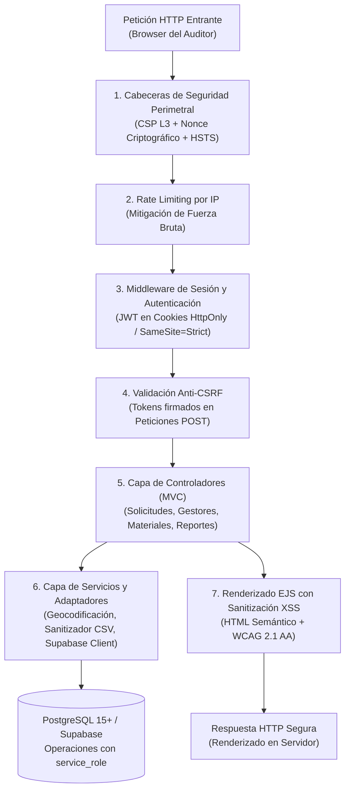

# EcoResiduos — Panel Administrativo y de Auditoría Ambiental

<div align="center">


**Sistema web de fiscalización documental, trazabilidad regional y mediación para autoridades ambientales y administradores**

*Jurisdicción: 6 Municipios de Santander (AMB / CDMB / CAS)*

</div>

---

## 1. Descripción del Subsistema

El **Panel Administrativo** de EcoResiduos es una plataforma web desarrollada en **Node.js y Express**, diseñada para que las autoridades ambientales (**CDMB**, **AMB**, **CAS**) y los administradores del sistema auditen la operación de recolección en los seis (6) municipios priorizados de Santander: **Bucaramanga, Floridablanca, Girón, Piedecuesta, Barrancabermeja y Sabana de Torres**.

### Funcionalidades Principales
- **Auditoría Documental de Gestores:** Revisión de licencias ambientales en PDF, validación de NIT, verificación de materiales autorizados por empresa y registro inmutable de decisiones administrativas (Aprobado, Rechazado, Suspendido).
- **Catálogo de Materiales y Peligrosidad:** Administración de la matriz de residuos bajo la **Resolución 2184 de 2019**, definiendo códigos de color oficiales, peligrosidad (RESPEL) y directrices técnicas de manejo.
- **Trazabilidad y Mediación de Novedades:** Panel de mediación de incidentes reportados por generadores o gestores durante la recolección física.
- **Consolidación Estadística y Reportes:** Generación de métricas de recolección por municipio y exportación de datos en formato CSV con sanitización contra inyección de fórmulas.

---

## 2. Arquitectura de Software y Pipeline de Mediación

El panel web implementa el patrón de diseño **Model-View-Controller (MVC)** con renderizado en el servidor (*Server-Side Rendering - SSR*) a través de EJS y una **tubería de seguridad en capas (*Middleware Pipeline*)**:



### Desglose de Capas Arquitectónicas

| Capa del Panel | Componentes Principales | Responsabilidad de Ingeniería |
|---|---|---|
| **Seguridad Perimetral** | `src/middlewares/` | Generación de nonces dinámicos para CSP L3, validación de firmas CSRF y control estricto de sesiones. |
| **Enrutamiento y Control** | `src/routes/`, `src/controllers/` | Mapeo RESTful de endpoints, validación de parámetros de entrada y mediación de transacciones administrativas. |
| **Servicios e Integración** | `src/services/`, `src/config/` | Clientes de persistencia Supabase (`service_role`), geocodificación de coordenadas y cálculo de métricas regionales. |
| **Presentación Accesible** | `src/views/`, `src/views/partials/` | Renderizado accesible conforme a WCAG 2.1 AA, navegación por teclado y contraste de color calibrado. |

---

### Estructura de Directorios del Código Fuente

```
admin-panel/
├── src/
│   ├── config/                   # Configuración del cliente Supabase (service_role) y entorno
│   ├── controllers/              # Controladores de solicitudes, gestores, materiales y reportes
│   ├── middlewares/              # Cadena de seguridad (Auth, CSRF, Nonces CSP, Rate Limit)
│   ├── routes/                   # Definición modular de rutas del servidor
│   ├── services/                 # Capa de integración con base de datos y geocodificación
│   ├── utils/                    # Sanitizadores de CSV, formateadores de fecha y helpers
│   ├── views/                    # Plantillas EJS estructuradas con protección contra XSS
│   ├── app.js                    # Configuración de Express, middlewares globales y rutas
│   └── server.js                 # Punto de entrada y arranque del servidor HTTP
│
├── pruebas/                      # Suite de 99 pruebas de integración, seguridad y WCAG
├── tailwind.config.js            # Configuración de diseño accesible conforme a WCAG 2.1 AA
└── package.json                  # Dependencias y scripts de construcción
```

---

## 3. Mecanismos de Seguridad Implementados

```
┌───────────────────────────────────────────────┬───────────────────────────────────────────────────────────────┐
│ Vector de Vulnerabilidad                      │ Mecanismo de Mitigación Implementado                          │
├───────────────────────────────────────────────┼───────────────────────────────────────────────────────────────┤
│ Cross-Site Scripting (XSS)                    │ Content Security Policy (CSP) L3 con nonces criptográficos    │
│                                               │ únicos por petición. Sin directivas unsafe-inline.            │
├───────────────────────────────────────────────┼───────────────────────────────────────────────────────────────┤
│ Cross-Site Request Forgery (CSRF)             │ Tokens anti-CSRF criptográficamente firmados y validados      │
│                                               │ en toda petición POST, almacenados en cookies HttpOnly.      │
├───────────────────────────────────────────────┼───────────────────────────────────────────────────────────────┤
│ Inyección de Fórmulas en CSV                  │ Sanitización automática de caracteres de escape (=, +, -, @) │
│                                               │ en todas las columnas de texto exportadas.                    │
├───────────────────────────────────────────────┼───────────────────────────────────────────────────────────────┤
│ Ataques de Fuerza Bruta en Autenticación      │ Middleware de limitación de tasa (Rate Limiting) por IP       │
│                                               │ y bloqueo temporal tras 5 intentos consecutivos fallidos.     │
├───────────────────────────────────────────────┼───────────────────────────────────────────────────────────────┤
│ Clickjacking y Sniffing de Tipos MIME         │ Cabeceras X-Frame-Options: DENY, X-Content-Type-Options:      │
│                                               │ nosniff y Strict-Transport-Security (HSTS en producción).     │
└───────────────────────────────────────────────┴───────────────────────────────────────────────────────────────┘
```

---

## 4. Instalación y Despliegue Local

### Prerrequisitos
- [Node.js](https://nodejs.org/) versión 18.x o superior.
- Gestor de paquetes `npm`.

### Configuración del Entorno

1. Navegar al directorio del panel:
   ```bash
   cd admin-panel
   ```

2. Crear el archivo de configuración `.env` a partir de la plantilla:
   ```bash
   cp .env.example .env
   ```

3. Configurar las variables requeridas:
   ```env
   PORT=3000
   NODE_ENV=development
   SUPABASE_URL=https://<tu-proyecto>.supabase.co
   SUPABASE_ANON_KEY=<tu_anon_key>
   SUPABASE_SERVICE_ROLE_KEY=<tu_service_role_key>
   COOKIE_SECRET=<clave_aleatoria_para_firmado_de_cookies>
   ```

4. Instalar dependencias del proyecto:
   ```bash
   npm install
   ```

5. Compilar los estilos de Tailwind CSS:
   ```bash
   npm run build:css
   ```

6. Iniciar el servidor en modo desarrollo:
   ```bash
   npm run dev
   ```
   Acceder a la interfaz web en: `http://localhost:3000`.

---

## 5. Suite de Pruebas Automatizadas (99 Tests)

El panel cuenta con una suite integral de 99 pruebas automatizadas ejecutadas mediante el test runner nativo de Node.js (`node --test`):

```bash
npm test
```

### Cobertura de Pruebas
- **Pruebas de Seguridad HTTP:** Verificación de cabeceras CSP, nonces, cookies seguras y HSTS.
- **Pruebas de Integridad CSRF:** Rechazo de peticiones sin token o con firmas manipuladas.
- **Auditoría de Accesibilidad:** Cumplimiento de **WCAG 2.1 Nivel AA** (ratios de contraste cromático > 4.5:1, etiquetas ARIA y navegación por teclado).
- **Lógica de Controladores y Negocio:** Flujos de aprobación y rechazo de gestores, auditoría de licencias PDF y exportación segura de reportes CSV.
