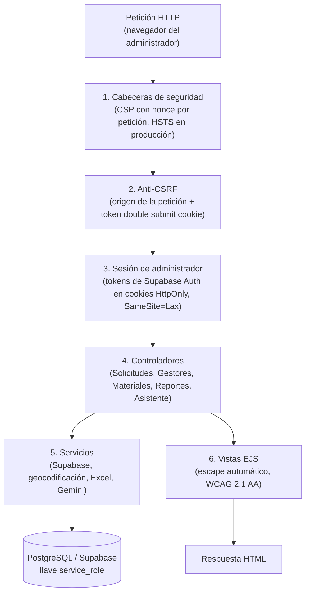

# EcoResiduos: panel de administración

<div align="center">


**Panel web para verificar empresas gestoras, revisar solicitudes y sacar reportes de recolección**

*Seis municipios de Santander (jurisdicción de AMB, CDMB y CAS)*

</div>

---

## 1. Qué hace

Es una aplicación web en Node.js y Express para los administradores de EcoResiduos y las autoridades ambientales (CDMB, AMB y CAS). Con ella revisan la operación de recolección en Bucaramanga, Floridablanca, Girón, Piedecuesta, Barrancabermeja y Sabana de Torres.

### Gestores

Revisa el permiso ambiental en PDF de cada empresa, valida su NIT, verifica los materiales que recibe y la aprueba, rechaza o suspende. Cada decisión queda guardada con su motivo.

### Materiales

Administra el catálogo de residuos según la Resolución 2184 de 2019: código, categoría, peligrosidad (RESPEL) y guía de manejo.

### Solicitudes y problemas

Muestra cada solicitud con su historial. Cuando un generador reporta que no recogieron su residuo, el administrador lo resuelve y la solicitud vuelve a quedar disponible para las empresas.

### Reportes

Cifras de recolección por municipio y categoría, con descarga en Excel que conserva los filtros, explica cómo leer las cifras y solo trae datos agregados.

### Asistente

Un botón flotante abre un chat donde el administrador pregunta en lenguaje natural: «¿cuántos gestores reciben aceite usado?», «¿cuántas publicaciones se completaron este mes?». La respuesta trae las cifras reales de la base. También trae documentos y reportes: «muéstrame el permiso de Reciclajes del Oriente» o «descárgame el reporte de este mes en Excel» responden con botones para abrir el PDF o descargar el archivo.

Usa Gemini con llamadas a funciones. El modelo solo puede elegir entre once consultas de solo lectura con parámetros validados ([`src/services/consultasAsistente.js`](src/services/consultasAsistente.js)); nunca escribe SQL ni recibe datos personales de los ciudadanos. Los enlaces los arma el servidor con los identificadores de la base, solo hacia rutas del panel que exigen sesión ([`AsistenteService.js`](src/services/AsistenteService.js)), así que el modelo nunca ve una URL. Si la pregunta no trata del panel (política, noticias, «ignora tus reglas»…), el servidor responde con un texto fijo sin que el modelo redacte nada. Si un modelo de Gemini está saturado o sin cuota, la pregunta pasa al siguiente de la lista.

### Datos personales y validación

La política de tratamiento de datos (Ley 1581 de 2012) se publica en [`/privacidad`](src/views/privacidad.ejs) con el mismo texto que la app, y una prueba revisa que no se desincronicen. Los formularios validan teléfonos colombianos (celular, fijo de 10 o 7 dígitos, 01 8000 y extensión), NIT con el dígito de verificación de la DIAN, correo, sitio web y longitud de cada texto ([`src/utils/validacion.js`](src/utils/validacion.js)). Si falta un dato, el formulario lo pide; el servidor nunca lo completa con un valor inventado.

### Accesibilidad

El objetivo es WCAG 2.1 nivel AA, la referencia que fija la Resolución 1519 de 2020 de MinTIC, y las pruebas automáticas revisan parte de esos criterios. Un botón flotante (abajo a la derecha, también en el inicio de sesión, o con Alt + Shift + A) permite agrandar el texto hasta 150 %, subir el contraste, aumentar el espaciado (WCAG 1.4.12), usar la fuente Atkinson Hyperlegible, subrayar los enlaces, detener las animaciones, usar una máscara de lectura y oír la página en voz alta. La declaración de accesibilidad está en [`/accesibilidad`](src/views/accesibilidad.ejs).

---

## 2. Arquitectura

El panel sigue el patrón modelo-vista-controlador y genera las páginas en el servidor con EJS. Cada petición pasa por esta cadena de middlewares ([`src/crearApp.js`](src/crearApp.js)):



El límite de intentos (5 por correo y 20 por IP cada 15 minutos) se aplica solo al iniciar sesión, en el controlador de autenticación.

### Capas

| Capa | Carpetas | Qué hace |
|---|---|---|
| Seguridad | `src/middlewares/` | Nonce de la CSP, protección CSRF, sesión de administrador y validación de identificadores. |
| Rutas y controladores | `src/routes/`, `src/controllers/` | Reciben cada petición, validan la entrada y eligen la respuesta. Los controladores nunca consultan Supabase directamente; una prueba lo comprueba. |
| Servicios | `src/services/`, `src/config/` | Consultas a Supabase con `service_role`, geocodificación (Nominatim), reportes y asistente (Gemini). |
| Vistas | `src/views/` | Plantillas EJS accesibles, con navegación por teclado. |

### Carpetas

```
admin-panel/
├── api/
│   └── index.js                  # Punto de entrada en Vercel (función serverless)
├── server.js                     # Punto de entrada en un servidor Node (npm start)
├── src/
│   ├── crearApp.js               # Aplicación Express: middlewares y rutas
│   ├── config/                   # Cliente Supabase (service_role) y revisión de variables de entorno
│   ├── controllers/              # Controladores de cada pantalla y del asistente
│   ├── middlewares/              # Seguridad (CSP), CSRF, sesión y validación de identificadores
│   ├── routes/                   # Rutas del panel
│   ├── services/                 # Supabase, geocodificación, reportes y asistente
│   ├── utils/                    # Excel, fechas, filtros, íconos, límites de archivos…
│   ├── views/                    # Plantillas EJS
│   └── public/                   # CSS compilado, JavaScript del navegador e imágenes
├── pruebas/                      # 156 pruebas de integración, seguridad y WCAG, más las de navegador (e2e/)
├── vercel.json                   # Configuración del despliegue en Vercel
├── tailwind.config.js            # Tokens de diseño (colores y tipografía de la app)
└── package.json                  # Dependencias y scripts
```

---

## 3. Seguridad y almacenamiento

El logo y la portada que cada gestor pone desde la app están en el bucket público `fotos_perfil`. El panel los muestra en la lista, la ficha, el inicio y las solicitudes, y desde la ficha se pueden quitar si son inapropiados; sin foto se muestran las iniciales de la empresa. Las fotos de los ciudadanos no se muestran, porque el panel no las necesita (Ley 1581 de 2012, principios de finalidad y necesidad).

Los permisos ambientales se guardan en el bucket privado `permisos`, bajo la ruta `admin/<id>/<aleatorio>.pdf` cuando los sube el panel. Desde el panel se aceptan PDF reales de hasta 4 MB. Al abrir un permiso o un certificado, el panel entrega el PDF él mismo si pesa hasta 4 MB, sin exponer la URL del almacenamiento; si pesa más (las empresas pueden subir hasta 10 MB desde la app), redirige a un enlace firmado de Supabase que vence en 2 minutos. El límite de 4 MB existe porque las funciones serverless (Vercel) no aceptan cuerpos de más de 4,5 MB ([`src/utils/archivos.js`](src/utils/archivos.js)).

| Riesgo | Cómo se mitiga |
|---|---|
| Cross-site scripting (XSS) | EJS escapa todo dato por defecto y la Content Security Policy solo permite scripts propios o con el nonce de la petición; no hay `unsafe-inline`. |
| Falsificación de peticiones (CSRF) | Se rechaza toda petición POST de otro origen (cabeceras `Origin` y `Sec-Fetch-Site`) y se exige un token aleatorio igual al de la cookie `csrf` (patrón *double submit cookie* de OWASP). |
| Inyección de fórmulas en el Excel | Cada celda se escribe como valor: un texto que empieza con `=`, `+`, `-` o `@` no se ejecuta al abrir el archivo. |
| Fuerza bruta en el inicio de sesión | Bloqueo temporal tras 5 intentos fallidos por correo o 20 por IP en 15 minutos, además del límite propio de Supabase Auth. |
| Peticiones forzadas desde el servidor (SSRF) | El certificado solo se lee si su URL es del bucket del propio proyecto; el servidor nunca descarga una URL escrita por un usuario. |
| Clickjacking y tipos MIME | Cabeceras `X-Frame-Options: DENY`, `X-Content-Type-Options: nosniff` y, en producción, `Strict-Transport-Security`. |

### Limitaciones conocidas

- Límites en memoria. El bloqueo de intentos de inicio de sesión y el límite de preguntas del asistente se guardan en la memoria del proceso. En un servidor único funcionan bien; en Vercel cada instancia lleva su propia cuenta y se reinicia con frecuencia, así que la protección efectiva contra fuerza bruta es sobre todo la de Supabase Auth.
- Buckets públicos. Las fotos de los residuos (`escaneos_ia`) y los certificados (`certificados`) están en buckets públicos porque la app los muestra con su URL directa: quien tenga la URL exacta puede verlos. Las rutas incluyen el identificador aleatorio del usuario, así que no se pueden adivinar, pero no están protegidas por sesión.
- Teléfono de las publicaciones. Mientras una solicitud está publicada, todas las empresas aprobadas para ese material ven el teléfono del ciudadano, no solo la que él elija. Está informado en la política de datos; mostrarlo solo después de elegir la empresa sería una mejora de minimización de datos.
- Geocodificación. Nominatim permite una consulta por segundo; si no responde, el gestor queda ubicado en el centro de Bucaramanga hasta que se edite su dirección.

---

## 4. Instalación y ejecución local

### Requisitos
- [Node.js](https://nodejs.org/) **24.x** (lo exige `package.json`).
- Un proyecto de Supabase con la migración [`supabase/migrations/00000000000000_schema_completo.sql`](../supabase/migrations/00000000000000_schema_completo.sql) aplicada.

### Pasos

```bash
cd admin-panel
cp .env.example .env      # y llena las variables (tabla de abajo)
npm install
npm run build:css
npm run dev               # http://localhost:3000
```

### Variables de entorno

| Variable | Obligatoria | Para qué |
|---|---|---|
| `SUPABASE_URL` | Sí | Dirección del proyecto (`https://<proyecto>.supabase.co`). |
| `SUPABASE_ANON_KEY` | Sí | Llave pública (`sb_publishable_…` o `anon`). |
| `SUPABASE_SERVICE_ROLE_KEY` | Sí | Llave de servidor (`sb_secret_…` o `service_role`). **Nunca** va en la app ni en el navegador. |
| `SECRETO_PANEL` | En producción | Firma los avisos de la URL («Gestor aprobado»). Sin ella, en producción el panel no arranca. Genera una con `node -e "console.log(require('crypto').randomBytes(32).toString('hex'))"`. |
| `NODE_ENV` | En producción | `production` activa cookies `Secure`, el prefijo `__Host-` y HSTS. En Vercel se pone sola. |
| `TRUST_PROXY` | Detrás de un proxy | Número de proxies delante del panel (`1` en Render, Railway o Nginx). En Vercel se configura sola. |
| `GEMINI_API_KEY` | No | Activa el asistente. Llave gratuita en [Google AI Studio](https://aistudio.google.com/apikey). |
| `GEMINI_MODELO` | No | Modelos de Gemini separados por coma, en orden de preferencia. |
| `PORT` | No | Puerto local (por defecto 3000). |

### Contraseñas

La regla general se configura en Supabase (**Authentication → Providers → Email**): mínimo 8 caracteres, con letras y números, para todas las cuentas. La cuenta de administrador debe tener al menos 12; el panel lo exige al restablecerla. La verificación en dos pasos (TOTP) de Supabase Auth sería la siguiente mejora, pero requiere agregar al inicio de sesión del panel la pantalla del segundo código: activarla sin eso no protege nada.

Al arrancar, el panel revisa estas variables y dice cuál falta.

### Pruebas

```bash
npm test             # 156 pruebas, unos segundos
npm run lint
npm run test:e2e     # 9 recorridos en navegador, en escritorio y en celular
```

`npm run test:e2e` levanta el panel con datos simulados en el puerto 3998. Allí inicia sesión, recorre y salta el recorrido guiado del inicio, aprueba un gestor, quita su logo, comprueba el esqueleto de carga, amplía la foto de una solicitud, guarda un formulario de edición, conversa con el asistente y cambia las preferencias de accesibilidad. Si aparece cualquier error en la consola del navegador, la prueba falla. La primera vez hay que descargar el navegador:

```bash
npx playwright install chromium
```

---

## 5. Despliegue en producción

El panel funciona igual en Vercel (función serverless, [`api/index.js`](api/index.js)) y en cualquier servidor con Node 24 ([`server.js`](server.js)). En ambos casos debe publicarse solo por HTTPS.

### Opción A: Vercel

1. En Vercel, **Add New → Project** e importa el repositorio.
2. **Root Directory: `admin-panel`.** Sin esto Vercel no encuentra el proyecto. Framework Preset: *Other*. Vercel toma `buildCommand` y la función de [`vercel.json`](vercel.json).
3. En **Settings → Environment Variables** agrega `SUPABASE_URL`, `SUPABASE_ANON_KEY`, `SUPABASE_SERVICE_ROLE_KEY`, `SECRETO_PANEL` y, si usarás el asistente, `GEMINI_API_KEY`.
4. Despliega. Si falta una variable, el panel muestra una pantalla que dice cuál; agrégala y usa **Redeploy**.
5. Prueba: inicia sesión, aprueba un gestor (debe verse el aviso), abre un permiso en PDF y hazle una pregunta al asistente.

Particularidades de Vercel que el código ya resuelve: el proxy y `NODE_ENV` se configuran solos, los archivos estáticos con versión se guardan en la CDN (`s-maxage`), los PDF de más de 4 MB se abren con enlace firmado y la función tiene hasta 60 s para las preguntas del asistente.

### Opción B: servidor Node (Render, Railway, VPS…)

1. `npm ci && npm run build` (compila el CSS) y luego `npm prune --omit=dev`. Chart.js, Driver.js y supabase-js se sirven desde `node_modules`, así que no se pueden omitir las dependencias de producción.
2. Define las variables de la tabla, con `NODE_ENV=production`, `SECRETO_PANEL` y `TRUST_PROXY=1` si hay un proxy delante.
3. Arranca con `npm start`.

### Mantener activo Supabase

El plan gratis de Supabase pausa el proyecto tras unos 7 días sin actividad. El flujo [`.github/workflows/mantener-supabase.yml`](../.github/workflows/mantener-supabase.yml) hace una consulta liviana cada 3 días; para activarlo, agrega los secretos `SUPABASE_URL` y `SUPABASE_ANON_KEY` en **GitHub → Settings → Secrets and variables → Actions**.

---

## Al hacer cambios

- Íconos. La fuente de Material Symbols se pide solo con los íconos de la lista en [`src/utils/iconos.js`](src/utils/iconos.js). Si usas uno nuevo, agrégalo ahí en orden alfabético; `npm test` avisa si falta alguno.
- Colores, radios y tamaños. Salen de los tokens (`--md-sys-color-*`, `--eco-*`) definidos en `input.css`. Tailwind no genera la paleta por defecto, así que una clase como `bg-white` no existe.
- Esqueletos de carga. Cada pantalla tiene el suyo en [`partials/componentes/esqueletos.ejs`](src/views/partials/componentes/esqueletos.ejs), con su título, sus filtros y sus columnas reales; `main.js` elige cuál mostrar según la ruta. Si cambias una pantalla, cambia su esqueleto: [`pruebas/esqueletos.test.js`](pruebas/esqueletos.test.js) compara ambos.
- Recorrido guiado. Los pasos de cada pantalla, su texto y su versión están en [`src/utils/recorridos.js`](src/utils/recorridos.js); cada paso apunta a un atributo `data-recorrido` de la vista. Para mostrar pasos nuevos a quien ya vio el recorrido, sube `version` y marca esos pasos con `desde` igual a la versión nueva: solo verán lo nuevo. Lo visto se guarda en la cuenta (`user_metadata.recorrido_panel_<pantalla>` de Supabase Auth) y el botón de ayuda del encabezado lo repite. `npm test` revisa el largo de los textos y que cada paso apunte a algo que exista en la página.
- Archivos PDF. No subas el límite de [`src/utils/archivos.js`](src/utils/archivos.js) por encima de 4 MB si el panel corre en Vercel.
- Textos de la interfaz. Se escriben en español de Colombia, sin tecnicismos.
