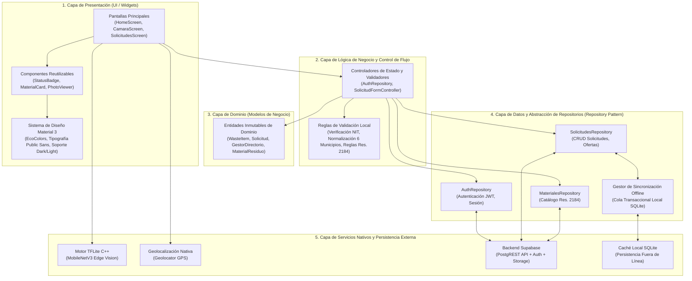

# EcoResiduos — Aplicación Móvil (Cliente Flutter)

<div align="center">


**Aplicación cliente con inferencia de visión computacional en el borde (*Edge ML*) para la gestión de residuos en los 6 municipios priorizados de Santander**

*(Bucaramanga, Floridablanca, Girón, Piedecuesta, Barrancabermeja y Sabana de Torres)*

</div>

---

## 1. Arquitectura de Software del Cliente Móvil

La aplicación cliente implementa una **Arquitectura en Capas orientada a Características (*Feature-First Layered Architecture*)**, estructurada para garantizar alta cohesión, bajo acoplamiento, capacidad de prueba (*testability*) y aislamiento de dependencias externas.



### Desglose de Capas y Responsabilidades

| Capa Arquitectónica | Componentes Principales | Responsabilidad de Ingeniería |
|---|---|---|
| **Presentación (UI)** | `lib/screens/`, `lib/widgets/`, `lib/theme/` | Renderizado declarativo accesible (WCAG 2.1 AA), respuesta táctil inmediata, soporte para temas claro/oscuro y navegación tipada. |
| **Lógica de Negocio** | `lib/features/auth/`, `lib/features/solicitudes/` | Control del ciclo de vida de operaciones, validación de reglas de negocio en cliente y despacho de eventos. |
| **Dominio** | `lib/models/`, `lib/data/` | Entidades inmutables de datos independientes de cualquier framework o fuente de persistencia. |
| **Acceso a Datos** | `lib/repositories/` | Implementación del **Repository Pattern**: expone contratos uniformes a la UI aislando si la información proviene de red, caché local o inferencia. |
| **Hardware / Borde** | `lib/services/ai/`, `lib/services/geo/` | Bindings en C++ para inferencia de red neuronal en memoria y acceso a sensores de ubicación GPS. |

### Patrones de Diseño e Ingeniería Aplicados

1. **Repository Pattern:** Desacopla la lógica de interfaz de los mecanismos de almacenamiento. La UI consume repositorios abstractos, lo que permite sustituir fuentes de datos en pruebas mediante *fakes* y *mocks* sin alterar la vista.
2. **Offline-First Optimistic Sync:** Cuando el dispositivo pierde la conectividad, las publicaciones se guardan en la base de datos local SQLite y se encolan automáticamente para ser retransmitidas al recuperar conexión a internet.
3. **Edge Vision Pipeline:** Pipeline lineal de inferencia que realiza captura, redimensionamiento bicúbico a $224 \times 224$, normalización de tenores Float32 en memoria, inferencia TFLite y clasificación jerárquica basada en umbrales probabilísticos.
4. **Dependency Inversion:** Todos los servicios y repositorios son inyectables, facilitando la ejecución de la suite de 117 pruebas automatizadas con 100% de éxito.

---

### Estructura de Directorios del Código Fuente

```
app/
├── assets/
│   ├── branding/                 # Identidad gráfica y logotipos del sistema
│   ├── fonts/                    # Tipografía Public Sans para renderizado offline
│   └── models/
│       ├── ecoresiduos_model.tflite # Modelo de visión cuantizado (Float32 / INT8)
│       └── labels.txt            # Diccionario de 8 clases del clasificador
│
├── lib/
│   ├── data/                     # Catálogo de categorías (Res. 2184/2019) y guías técnicas
│   ├── features/
│   │   ├── auth/                 # Autenticación, registro dual y verificación de gestores
│   │   └── solicitudes/          # Publicación, negociación, retiro y descarga de certificados
│   ├── models/                   # Entidades de dominio (WasteItem, Gestor, Solicitud)
│   ├── repositories/             # Contratos e implementaciones de acceso a datos
│   ├── screens/                  # Vistas principales de navegación y flujos de usuario
│   ├── services/                 # Servicios de visión TFLite, geolocalización y cliente HTTP
│   ├── theme/                    # Tokens de diseño Material Design 3 y paleta EcoColors
│   ├── utils/                    # Validadores de NIT, normalización y geocodificación
│   └── widgets/                  # Componentes reutilizables y estados de carga
│
└── test/                         # 117 pruebas unitarias, de servicios, repositorios y widgets
```

---

## 2. Roles y Flujos de Usuario

La aplicación soporta dos perfiles operativos con experiencias adaptadas a sus funciones:

```
┌───────────────────────────────────────────────┬───────────────────────────────────────────────┐
│ Generador (Hogares, Comercios e Industrias)   │ Empresa Gestora Ambiental (Autorizada por CAR)│
├───────────────────────────────────────────────┼───────────────────────────────────────────────┤
│ • Clasificación asistida por visión artificial│ • Consulta de solicitudes según su licencia   │
│ • Publicación georreferenciada de residuos    │ • Envío de cotizaciones y propuestas          │
│ • Comparación y adjudicación de cotizaciones  │ • Registro de recolección física en predio    │
│ • Confirmación de entrega y descarga de PDF   │ • Cargue de certificados de disposición final │
└───────────────────────────────────────────────┴───────────────────────────────────────────────┘
```

---

## 3. Inferencia de Visión Computacional (*On-Device ML*)

El servicio de clasificación visual opera de forma autónoma dentro del hardware del teléfono inteligente, ejecutando el modelo **MobileNetV3 Large** mediante los bindings nativos en C++ de `tflite_flutter`:

```
┌─────────────────┐     ┌──────────────────────┐     ┌─────────────────────┐     ┌────────────────────┐
│ Captura de Foto │ ──> │ Normalización        │ ──> │ Inferencia TFLite   │ ──> │ Clasificación y    │
│ (Cámara/Galería)│     │ 224 × 224 px [0,255] │     │ MobileNetV3 Large   │     │ Guía Res. 2184/2019│
└─────────────────┘     └──────────────────────┘     └─────────────────────┘     └────────────────────┘
```

- **Clases reconocidas:** `APROVECHABLE`, `ORGANICO`, `ORDINARIO`, `PELIGROSO`, `RAEE`, `RCD`, `RIESGO_BIOLOGICO` y `FONDO`.
- **Control de capturas vacías:** La clase `FONDO` detecta y descarta automáticamente imágenes que no corresponden a residuos sólidos.
- **Estratificación de confianza:** Si la probabilidad Softmax de la clase ganadora supera el 85%, el resultado se presenta de inmediato; entre 40% y 84% se sugieren opciones afines; y por debajo de 40% se solicita verificación manual.

---

## 4. Requisitos y Configuración de Desarrollo

### Prerrequisitos
- [Flutter SDK](https://docs.flutter.dev/get-started/install) versión 3.24.0 o superior.
- [Android Studio](https://developer.android.com/studio) o [VS Code](https://code.visualstudio.com/) con plugins de Flutter y Dart.
- Dispositivo físico o emulador (Android 8.0+ / iOS 14.0+).

### Pasos de Ejecución

1. Clonar el repositorio y acceder al directorio de la aplicación:
   ```bash
   cd app
   ```

2. Descargar las dependencias del proyecto:
   ```bash
   flutter pub get
   ```

3. Verificar la presencia del modelo cuantizado en `assets/models/`:
   ```bash
   # Debe contener ecoresiduos_model.tflite y labels.txt
   ls assets/models/
   ```

4. Ejecutar la aplicación en modo depuración:
   ```bash
   flutter run
   ```

---

## 5. Batería de Pruebas Automatizadas (117 Tests)

La aplicación cuenta con una cobertura integral de pruebas que validan lógica de negocio, inferencia y renderizado de componentes:

```bash
flutter test
```

### Áreas Validadas en la Suite
- **Autenticación y Registro:** Validación de formatos de NIT, vinculación con directorio oficial y registro de gestores con PDF.
- **Inferencia de Visión:** Pruebas unitarias de preprocesamiento de tensores, cálculo de Softmax y discriminación de la clase `FONDO`.
- **Publicación y Negociación:** Flujos de creación de solicitudes, cálculo de geolocalización y cola de sincronización offline.
- **Pruebas de Humo y Accesibilidad:** Renderizado completo de todas las pantallas en temas claro y oscuro, validando contrastes y tamaños táctiles mínimos.
